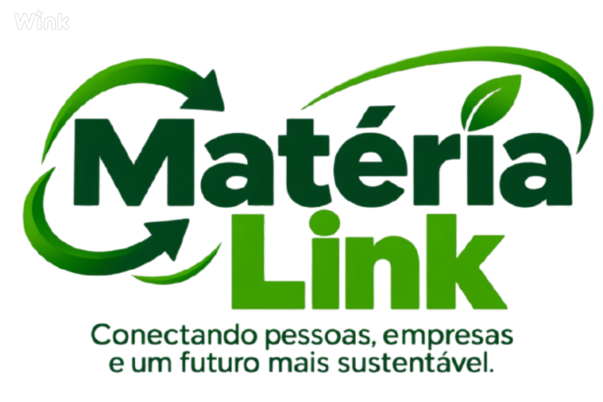

<h3 align="center">Conectando pessoas, empresas e um futuro mais sustentável.</h3>
<b>♲ Sobre o projeto </b>  
O Matéria-Link é um Projeto Integrador (PI) do curso de Desenvolvimento de Software Multiplataforma, que tem como objetivo desenvolver uma plataforma para conectar pessoas e empresas interessadas no reaproveitamento e na negociação de materiais recicláveis, sobras de alimentos e matérias-primas.
A proposta é incentivar a sustentabilidade, reduzir o desperdício e promover a economia circular por meio da tecnologia. 
 <b>♲ Tecnologias</b> 
 

HTML5: estruturação das páginas da aplicação.  
CSS3: estilização e identidade visual. 
JavaScript: implementação de funcionalidades e interatividade. 
Bootstrap: desenvolvimento de interfaces responsivas e componentes visuais. 
 
 <b>♲ Como executar o projeto</b>  
Para executar o Matéria-Link em sua máquina, siga os passos abaixo:
 
1. Clone o repositório: <code>git clone GitHub - K44LI/materia.link: projeto integrador</code>
2. Acesse a pasta do projeto: <code>cd Materia-Link</code>
3. Abra o projeto:
Abra o arquivo index.html diretamente no navegador ou utilize a extensão Live Server no Visual Studio Code para executar a aplicação em um servidor local.
4. Visualize a aplicação:
Após iniciar o projeto, a página inicial será exibida no navegador.
Não é necessário instalar dependências adicionais para a execução da versão estática em HTML, CSS e JavaScript. 

<b>♲ Estrutura de pastas</b> 
A organização do projeto segue uma estrutura que facilita a manutenção e a localização dos arquivos.
 
Materia-Link/  
│ 
├── css/ 
│   └── css.style 
│ 
├── img/ 
│   └── imagensusadas.png 
│ 
├── js/ 
│   └── pages 
│     └── pages.js 
│   └── actions.js 
│   └── app.js 
│   └── core.js 
│   └── data.js 
│ 
├── html 
│   └── busca.html 
│   └── cadastrar.html 
│   └── cadastro.html 
│   └── chat.html 
│   └── favoritos.html 
│   └── home.html 
│   └── index.html 
│   └── mapas.html 
│   └── material.html 
│   └── perfil.html 
│ 
└── README.md 

 <b>♲ Regras da equipe</b>  
1- Não realizar commits diretamente na main.  
2- Cada tarefa deve ter sua própria branch (feature/nome-da-tarefa). 
3- Todo Pull Request precisa da revisão de pelo menos um colega. 
4- Mensagens de commit devem ser escritas no imperativo (Adiciona, Corrige, Atualiza...). 
5- Executar git pull antes de começar a trabalhar. 
 <b>♲ Status</b>

Desenvolvido pela equipe Matéria-Link.
 
<strong>Projeto Integrador | Desenvolvimento de Software Multiplataforma</strong>

